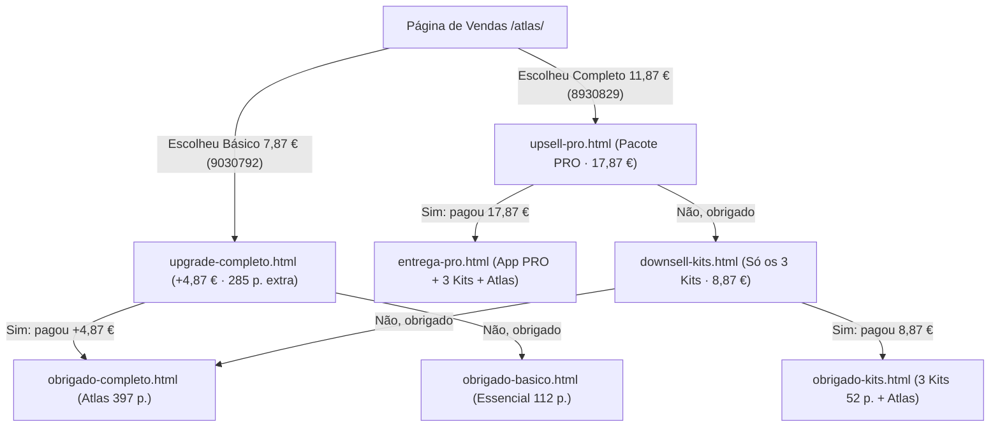

# Relatório Executivo — Funil Pós-Compra Atlas V8 (`site_clone/funil-v8/`)

- **Ramo Git**: `funil-v8` (criado a partir de `origin/main` em `fb98155`; **não publicado**, **não feito push**, **não mexido no painel Hotmart**).
- **Regra de segurança cumprida**: o ramo local `main` (`b818a80`) não foi utilizado como base por remover ficheiros em `entregaveis/`. Os `23` ficheiros rastreados de `entregaveis/` permanecem intactos.

---

## 1. O que foi construído em `site_clone/funil-v8/`

Sete páginas estáticas mobile-first em **Português de Portugal (`pt-PT`)**, seguindo exatamente o sistema visual editorial clínico de `atlas/index.html` (`#FAF7F2`, `#0B1B2B`, `#DFA326`, fontes auto-hospedadas `Manrope` e `Inter`), ligadas por CSS/JS partilhados e com Meta Pixel `1627467939032653` + repasse completo de UTMs/`fbclid`/`src`/`sck`/`xcod`:

1. **`upsell-pro.html`** — Upsell 1 para compradores do **Atlas Completo (11,87 €)**: oferta do **Pacote PRO (App ElectroMapas PRO + 3 Kits A4 verticais)** proposta a **`17,87 €`** (botão Hotmart `B108418889J?off=PENDENTE_OFF_PRO_1787`).
2. **`downsell-kits.html`** — Downsell para quem recusou o PRO: oferta de **Só os 3 Kits em A4 vertical (52 páginas no total, sem a App)** proposta a **`8,87 €`** (botão Hotmart `G108419033I?off=PENDENTE_OFF_KITS_887`).
3. **`upgrade-completo.html`** — Upgrade pós-compra para compradores do **Básico / Essencial (7,87 €)**: *"Leva as outras 285 páginas do Atlas Completo por mais 4,87 €"* (botão Hotmart `K108418562E?off=PENDENTE_OFF_UPGRADE_487`).
4. **`obrigado-basico.html`** — Entrega limpa para quem comprou o **Essencial (112 p.)** e recusou o upgrade (instruções Hotmart + MB WAY/Multibanco).
5. **`obrigado-completo.html`** — Entrega limpa para quem comprou o **Atlas Completo (397 p.)** e recusou upsell/downsell **ou** aceitou o upgrade do Básico → Completo.
6. **`entrega-pro.html`** — Entrega limpa para quem comprou o **Pacote PRO**: destaque para abrir `/electromapas-pro-app`, instruções de ativação (e-mail ou código `HP...` Hotmart), instalação PWA no iOS/Android e acesso aos 3 kits + Atlas na Hotmart.
7. **`obrigado-kits.html`** — Entrega limpa para quem aceitou o downsell **Só os 3 Kits**: resumo dos 4 ficheiros na Hotmart e orientação prática de impressão/uso.
8. **Suporte técnico e QA**: `funnel-v8.css`, `funnel-v8.js`, 6 pré-visualizações reais exportadas a 150 dpi dos PDFs (`kit1-*.webp`, `kit2-*.webp`, `kit3-*.webp`) + 1 captura real da calculadora da App PRO (`img/app-pro-calculadora.webp`), `QA.md` e 13 capturas em `qa/`.

---

## 2. Diagrama do Funil V8

---

## 3. Auditoria do Produto Real: O que Existe vs. Sobreposição vs. O que Falta Criar

A inspeção página a página via PyMuPDF e leitura direta de `origin/main:app/index.html` revelou os seguintes factos:

| Produto / Ficheiro | Estado Real Verificado | Relação / Sobreposição com o Atlas 397p | Decisão Aplicada nas Páginas V8 |
|---|---|---|---|
| `ElectroMapas_Essencial_112p.pdf` (`PACOTE_HOTMART_PRONTO/0_Basico_7_87/`) | **Existe** (`112 p.`, `44 mapas` + `44 fichas` + tabela resumo + checklist + bibliografia). | Base do Atlas Completo. | Diferença exata para o Completo = **`+285 páginas`** (`+26 mapas`, `59 p.` anatomia, `47 p.` guias NICE/Cochrane, `42 p.` correntes, `39 p.` inverno, `39 p.` segurança/19 formulários, `6 p.` índices/auditoria). |
| `ElectroMapas_Kit1_Bolso.pdf` (`2_Pacote_PRO_25_97/` e `3_Downsell_Kits_12_97/`) | **Existe** (`17 p.`, A4 vertical). | **Alta sobreposição**: `p. 5–17` (`T05–T41`, `SG01/13/22`) vêm do Atlas; **único conteúdo reestruturado novo** é a tabela consolidada dos `70 mapas` em `p. 2–4`. | Apresentado com verdade como **edição A4 vertical para o ecrã do telemóvel** + tabela consolidada de 70 mapas (com nota de transparência explícita). |
| `ElectroMapas_Kit2_Clinica.pdf` | **Existe** (`21 p.`, A4 vertical). | **100% extraído do Atlas**: formulários `SG18–SG37` (consentimento, bandeiras vermelhas, `11` escalas, registo de sessão, diário TENS, alta) reformatados num PDF separado. | Apresentado honestamente como **pasta vertical pronta a imprimir** sem ter de procurar no meio das 397 páginas. |
| `ElectroMapas_Kit3_Pacientes_Inverno.pdf` | **Existe** (`14 p.`, A4 vertical). | **`PX01–PX10` são 100% EXCLUSIVOS** (não constam do Atlas 397p); apenas `WX23` e `WX24` constam do Atlas. | Destacado como o principal ativo exclusivo em PDF para entregar aos utentes. |
| `App ElectroMapas PRO` (`origin/main:app/index.html`) | **Existe e funciona** (`PWA offline`, calculadora `mA/cm²`, `16` protocolos pesquisáveis, `8` regiões anatómicas, checklist de segurança, gerador `SOAP` com delta EVA, `2` vídeos `.mp4` em `pt-PT`). | **Não está sincronizada com os 70 mapas v7** (mantém base de `16 protocolos` / `8 regiões` com referências gerais Nussbaum/Baker/Johnson). Bloqueio de licença depende de webhook + Redis/KV em produção. | Descrita com rigor pelo que realmente faz hoje (`mA/cm²`, `16` protocolos, `8` regiões, `SOAP`). **Proibido prometer "70 mapas na App" ou "vídeos de todas as regiões" antes da atualização.** |
| Produto Hotmart `8931107` (3 Kits) | **Sem PDF carregado na Hotmart** (conforme `MISSAO_AGY_FUNIL_UPSELL_V8.md`), embora os 3 PDFs existam localmente idênticos em `3_Downsell_Kits_12_97/`. | Bloqueador operacional na Hotmart até upload. | Sinalizado como **obrigatório para o Claude subir os 3 ficheiros** antes de ativar o downsell. |
| Ativos legados em `site_clone/entregaveis/` | Existem `Casos_Clinicos_Eletroterapia_20_Raciocinios.pdf` (`25 p.`) e `Kit_Comunicacao_Retencao_Utente.pdf` (`15 p.`). | `Casos Clínicos` casa diretamente com a dor *"já sei onde pôr; agora porquê e como programar"*, mas ambos têm `0 PMIDs` — não passaram ainda pela revisão clínica v7 (`fisioterapeuta-revisor`). | **Não incluídos na venda atual do V8** para não prometer conteúdo não revisto. Listados abaixo como material a criar/rever para subir o PRO para `25,97 €`. |

### O que falta criar para justificar o Pacote PRO a 25,97 € no futuro
Se quiserem regressar aos `25,97 €` sem risco de reembolso por perceção de valor duplicado:
1. **Rever clinicamente (com PMID/DOI v7) o caderno `Casos_Clinicos_Eletroterapia_20_Raciocinios.pdf`** (acrescentando secção objetiva *"como programar passo a passo no aparelho: modo, Hz, µs, rampa, On/Off e critério de intensidade"*).
2. **Atualizar `app/index.html`** para incluir a base completa dos `70 mapas v7` (ou pelo menos os `70` cartões com pesquisa por condição e temporizador de ciclo On/Off/rampa).

---

## 4. Preços Propostos e Fundamentação

| Oferta | Preço Antigo | Preço Proposto V8 | Justificação (`offers` + `pricing` + `marketing-psychology`) |
|---|---|---|---|
| **Upgrade Básico → Completo** (Produto `8930829`) | Inexistente | **`4,87 €`** *(total com Básico: 12,74 €)* | Ancoragem direta contra o Completo avulso (`11,87 €`): pagar apenas `+4,87 €` poupa `7,00 €` face a comprar separado e mantém a escada coerente para quem entrou pelo preço menor. |
| **Upsell 1 · Pacote PRO** (Produto `8931029`) | `25,97 €` | **`17,87 €`** | Com o inventário real atual (App com 16 protocolos + 10 folhetos exclusivos + 2 kits reformatados do Atlas), `25,97 €` (`2,19×` o Atlas) gera risco de desilusão ("isto já estava no Atlas"). A `17,87 €` (`1,5×` o Atlas), a App `mA/cm²`/`SOAP` + os `10` folhetos exclusivos sustentam o preço com margem e baixa taxa de reembolso. |
| **Downsell · Só os 3 Kits** (Produto `8931107`) | `12,97 €` | **`8,87 €`** | **Correção crítica**: `12,97 €` pelos 3 kits (52 p.) era mais caro do que o próprio Atlas Completo de 397 páginas (`11,87 €`), violando a perceção de valor. A `8,87 €` fica `9,00 €` abaixo do PRO e abaixo do Atlas, funcionando como verdadeira versão menor acessível. |

> **Alternativa imediata (se o Jel preferir manter `25,97 €` e `12,97 €` já existentes na Hotmart sem criar novas ofertas para PRO/Kits):**
> - Em `funil-v8/upsell-pro.html`: substituir `17,87 €` / `17.87` por `25,97 €` / `25.97` e trocar `PENDENTE_OFF_PRO_1787` por `7efptb20`.
> - Em `funil-v8/downsell-kits.html`: substituir `8,87 €` / `8.87` por `12,97 €` / `12.97` e trocar `PENDENTE_OFF_KITS_887` por `8ocd86ai` (mas **não ativar sem antes subir os 3 PDFs no produto `8931107`**).

---

## 5. LISTA EXATA DE CONFIGURAÇÕES HOTMART E DEPLOY (PARA O CLAUDE EXECUTAR)

Substitui `<DOMINIO>` pelo domínio real em produção na Vercel onde o projeto está publicado. Como `vercel.json` tem `"cleanUrls": true`, os ficheiros em `funil-v8/` respondem automaticamente em `https://<DOMINIO>/funil-v8/<nome-da-pagina>`.

### Passo 1 — Subir ficheiros em falta na Hotmart
- **Produto `8931107` (Só os 3 Kits)**:
  - Carregar na Área de Membros / Ficheiros os **3 PDFs** da pasta local:
    - `PACOTE_HOTMART_PRONTO/3_Downsell_Kits_12_97/ElectroMapas_Kit1_Bolso.pdf`
    - `PACOTE_HOTMART_PRONTO/3_Downsell_Kits_12_97/ElectroMapas_Kit2_Clinica.pdf`
    - `PACOTE_HOTMART_PRONTO/3_Downsell_Kits_12_97/ElectroMapas_Kit3_Pacientes_Inverno.pdf`
- **Produto `8931029` (Pacote PRO)**:
  - Confirmar que os mesmos 3 PDFs de `PACOTE_HOTMART_PRONTO/2_Pacote_PRO_25_97/` estão carregados na Área de Membros + adicionar módulo de acesso à App com link `https://<DOMINIO>/electromapas-pro-app`.

### Passo 2 — Criar as 3 ofertas novas na Hotmart e colar os códigos `?off=`
1. **No produto `8930829` (Atlas Completo)**:
   - Criar oferta **"Upgrade Pós-Compra Básico → Completo"** ao preço de **`4,87 €`** (IVA incluído).
   - Copiar o código `?off=XXXXXX` gerado pela Hotmart e substituir `PENDENTE_OFF_UPGRADE_487` em `funil-v8/upgrade-completo.html`.
2. **No produto `8931029` (Pacote PRO)**:
   - Criar oferta **"Pacote PRO Pós-Compra V8"** ao preço de **`17,87 €`** (IVA incluído).
   - Copiar o código `?off=YYYYYY` e substituir `PENDENTE_OFF_PRO_1787` em `funil-v8/upsell-pro.html`. *(Se optar por manter `25,97 €`, usar `off=7efptb20` e atualizar o preço visível na página).*
3. **No produto `8931107` (Só os 3 Kits)**:
   - Criar oferta **"3 Kits Downsell V8"** ao preço de **`8,87 €`** (IVA incluído).
   - Copiar o código `?off=ZZZZZZ` e substituir `PENDENTE_OFF_KITS_887` em `funil-v8/downsell-kits.html`. *(Se optar por manter `12,97 €`, usar `off=8ocd86ai` e atualizar o preço visível).*

### Passo 3 — Configurar as Páginas de Obrigado Personalizadas por Produto/Oferta na Hotmart
**Importante**: usar redirecionamento normal da Página de Obrigado da Hotmart (sem ativar o widget de 1-clique nesta etapa, para compatibilidade total com MB WAY / Multibanco).

| Produto Hotmart | Oferta | Preço | URL exato de "Página de obrigado" a configurar na Hotmart |
|---|---|---|---|
| **Básico Essencial (`9030792`)** | `1aepdmuf` | `7,87 €` | `https://<DOMINIO>/funil-v8/upgrade-completo` |
| **Atlas Completo (`8930829`)** | `csi2p45d` | `11,87 €` | `https://<DOMINIO>/funil-v8/upsell-pro` |
| **Atlas Completo (`8930829`)** | Nova (`PENDENTE_OFF_UPGRADE_487`) | `4,87 €` | `https://<DOMINIO>/funil-v8/obrigado-completo` |
| **Pacote PRO (`8931029`)** | Nova (`PENDENTE_OFF_PRO_1787` ou `7efptb20`) | `17,87 €` *(ou 25,97 €)* | `https://<DOMINIO>/funil-v8/entrega-pro` |
| **Só os 3 Kits (`8931107`)** | Nova (`PENDENTE_OFF_KITS_887` ou `8ocd86ai`) | `8,87 €` *(ou 12,97 €)* | `https://<DOMINIO>/funil-v8/obrigado-kits` |

### Passo 4 — Verificar Webhook da App PRO e Variáveis na Vercel
- No painel da Hotmart (Ferramentas → Webhook / API), confirmar webhook ativo no produto **`8931029` (Pacote PRO)** para os eventos `PURCHASE_APPROVED`, `PURCHASE_COMPLETE`, `PURCHASE_REFUNDED`, `PURCHASE_CHARGEBACK`, `PURCHASE_CANCELED`, apontando para:
  `https://<DOMINIO>/api/hotmart-webhook`
- Na Vercel, confirmar que estão definidas as variáveis de ambiente exigidas por `api/hotmart-webhook.js` e `api/verify-license.js`:
  - `HOTMART_HOTTOK`
  - `UPSTASH_REDIS_REST_URL` e `UPSTASH_REDIS_REST_TOKEN` (ou `KV_REST_API_URL` e `KV_REST_API_TOKEN`)
  - *(Opcional recomendado)* `LICENSE_SERVER_SECRET`

### Passo 5 — Verificação Pré-Publicação e Merge
1. Rever os ficheiros no ramo `funil-v8` e confirmar substituição dos 3 placeholders `PENDENTE_OFF_*`.
2. Fazer merge de `funil-v8` para `origin/main` (**nunca** a partir do `main` local antigo `b818a80`).
3. Após deploy na Vercel, executar compra real de teste (Cartão e MB WAY):
   - Fluxo Básico: `7,87 €` → `upgrade-completo` (`4,87 €`) → `obrigado-completo` + recusa → `obrigado-basico`.
   - Fluxo Completo: `11,87 €` → `upsell-pro` (`17,87 €`) → `entrega-pro` (testar ativação na App PRO!) + recusa → `downsell-kits` (`8,87 €`) → `obrigado-kits` + recusa → `obrigado-completo`.
4. Confirmar no Meta Events Manager que o site envia apenas `PageView`, `ViewContent` e `InitiateCheckout` (sem `Purchase` duplicado no navegador) e que a Hotmart recebe `src`, `sck`, `xcod` e `utm_*`.
